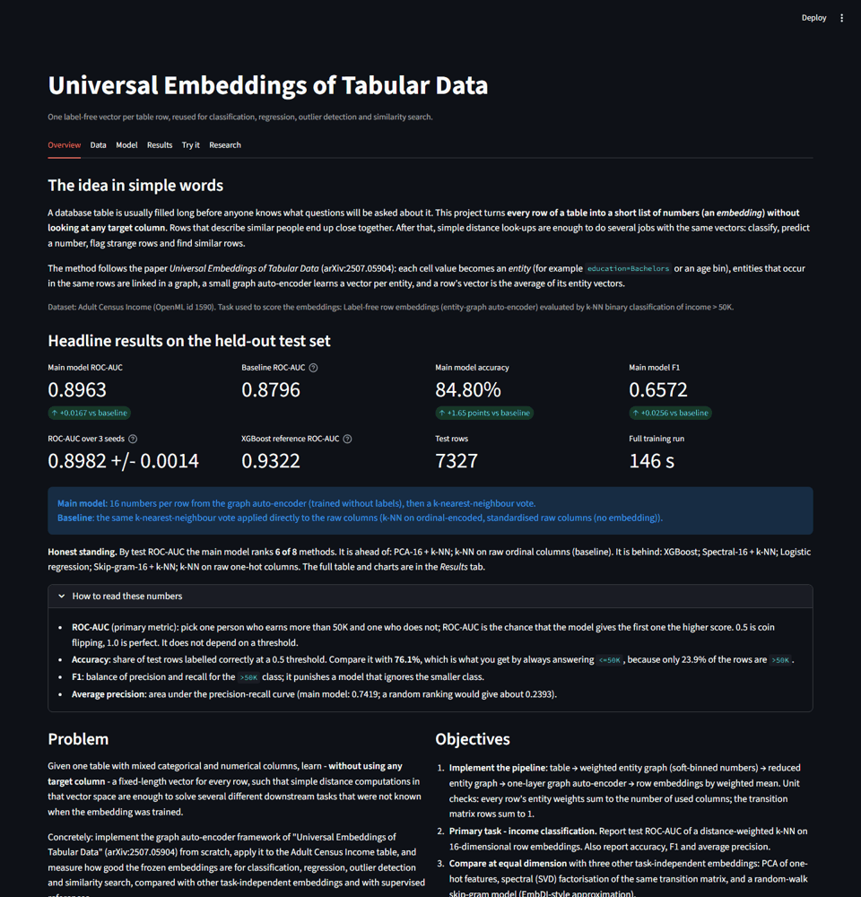
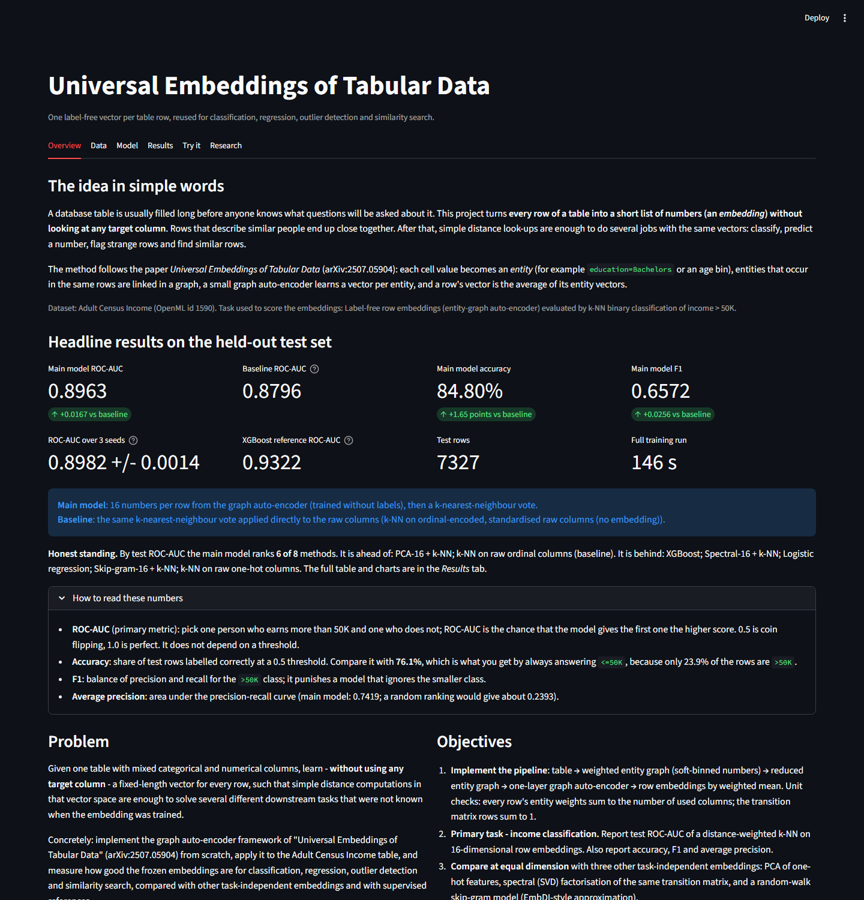
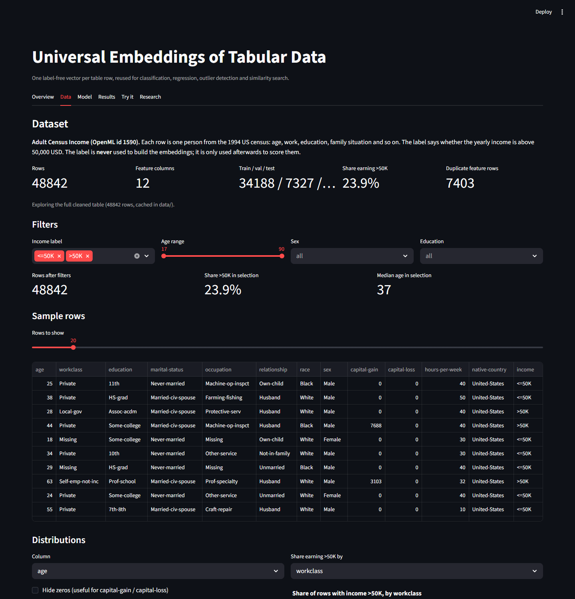
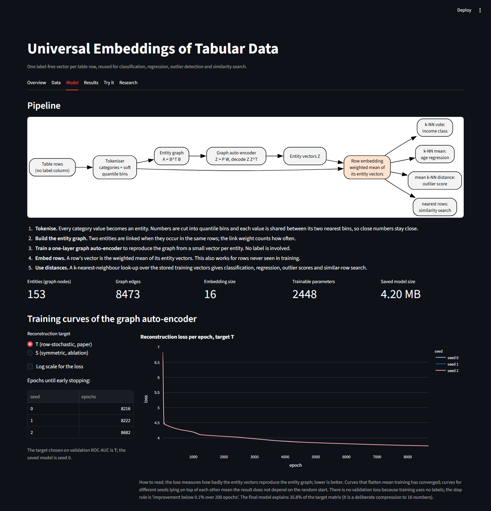
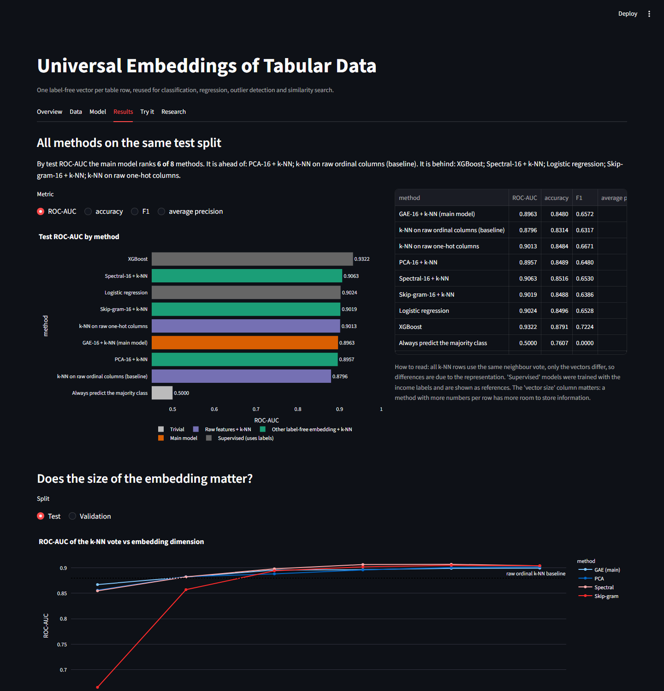
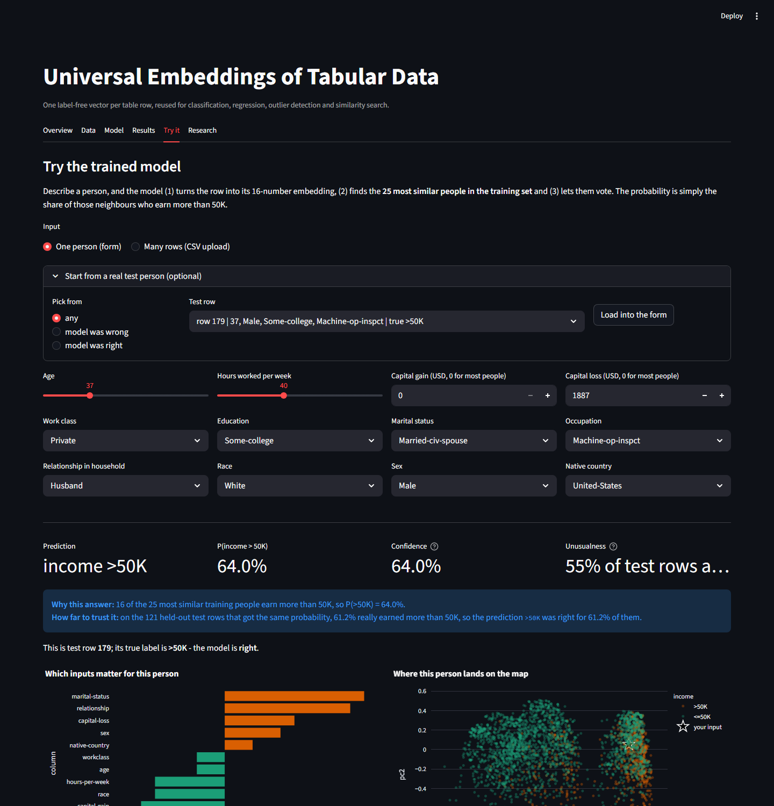
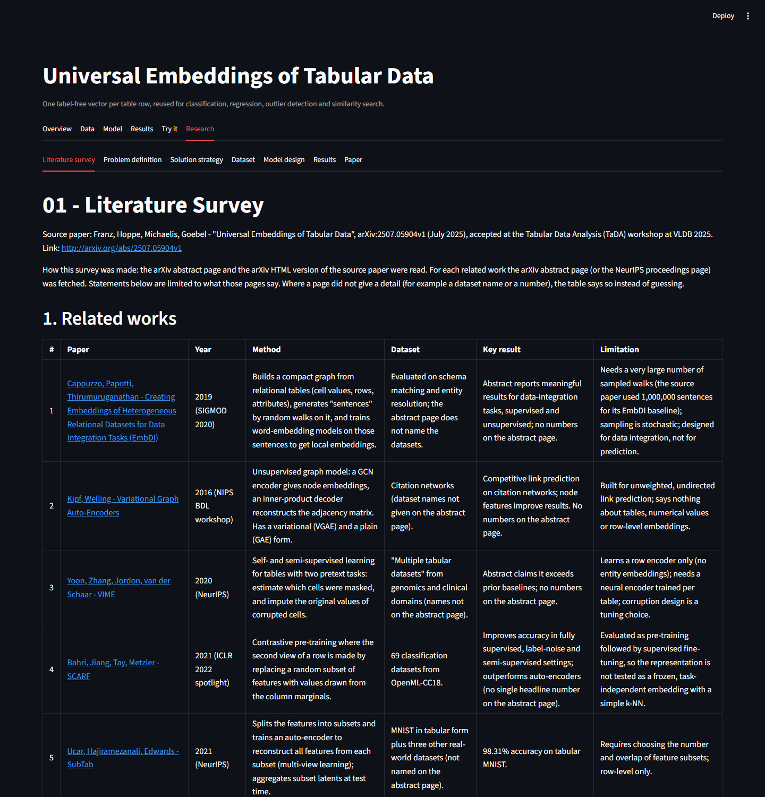
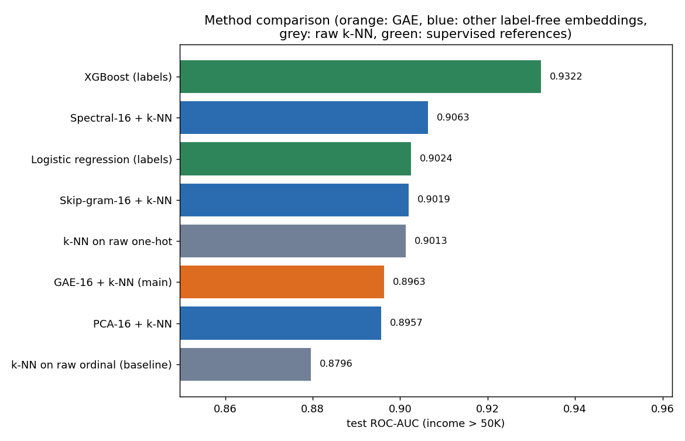
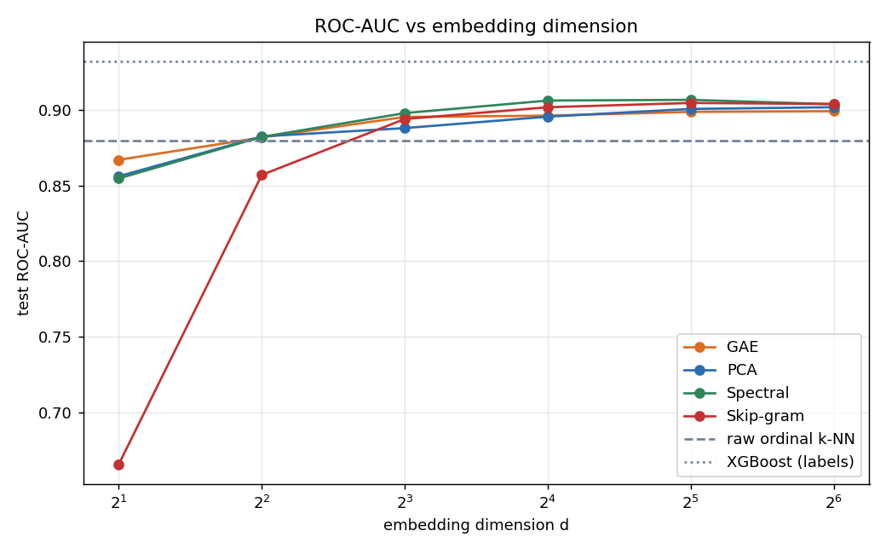
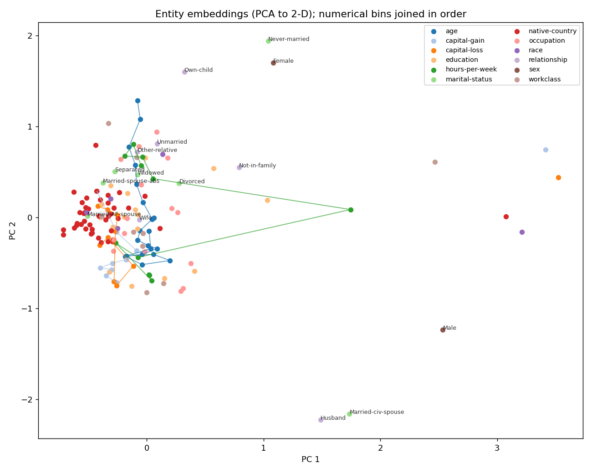

# Universal Embeddings of Tabular Data

**Live dashboard:** [https://universal-embeddings-of-tabular-dat.vercel.app](https://universal-embeddings-of-tabular-dat.vercel.app) - the full interactive dashboard (all tabs, live predictions) running in your browser; nothing to install. The first visit takes about a minute to load.


A from-scratch, CPU-only reproduction of the entity-graph auto-encoder from the paper
*Universal Embeddings of Tabular Data* (arXiv:2507.05904), tested on the Adult Census Income
table. The pipeline turns every table row into a 16-number vector **without ever looking at a
target column**: categories and numerical bins become nodes of a weighted graph, a one-layer
graph auto-encoder (GAE) learns one vector per node, and a row is the weighted mean of its
nodes. The same frozen vectors are then reused for income classification, age regression,
outlier detection and similarity search with a plain k-nearest-neighbour rule, and compared
with PCA, a spectral factorisation, a random-walk skip-gram model, raw-feature k-NN, logistic
regression and XGBoost. Everything trains in about 2.5 minutes on a laptop CPU and can be
explored in an interactive Streamlit dashboard.

## Dashboard preview

Screenshots of the interactive dashboard (`streamlit run app.py`), captured automatically from the running app.



<details><summary>Every tab as a still image</summary>

**Overview**



**Data**



**Model**



**Results**



**Try It**



**Research**



</details>

## Results at a glance

All numbers come from `artifacts/metrics.json`, written by `python train.py`
(test split: 7,327 rows; primary metric: ROC-AUC for predicting income > 50K).

| Method | Sees labels when building features? | Test ROC-AUC |
|---|---|---|
| **GAE row embedding (16-d) + k-NN - main model** | **no** | **0.8963** |
| k-NN on ordinal-encoded raw columns - baseline | no | 0.8796 |
| PCA (16-d) + k-NN | no | 0.8957 |
| Skip-gram (16-d, EmbDI-style approximation) + k-NN | no | 0.9019 |
| Spectral factorisation (16-d) + k-NN | no | 0.9063 |
| k-NN on raw one-hot (106-d) | no | 0.9013 |
| Logistic regression | yes | 0.9024 |
| XGBoost | yes | 0.9322 |

- The main model beats the baseline by **+0.0167** ROC-AUC and is stable over seeds
  (0.8982 +- 0.0014 over 3 seeds).
- Honest finding: it is **not** the best label-free embedding here. A closed-form spectral
  factorisation of the same graph is better (0.9063), and so is the skip-gram model (0.9019).
- Where the GAE does best: very small embeddings (0.8671 at 2 dimensions, the best of the four
  embedding methods) and outlier detection (ROC-AUC 0.7954 vs 0.7520 for PCA and 0.7567 for
  one-hot).
- Other uses of the same pipeline: age regression with the age column hidden reaches R^2 0.414
  (MAE 8.02 years vs 11.16 for predicting the mean).







Full tables, all 11 plots and the error analysis: [docs/06_results.md](docs/06_results.md).

## What you get

The dashboard (`streamlit run app.py`) has six tabs:

| Tab | What it shows |
|---|---|
| **Overview** | The idea in simple words, headline metrics against the baseline, problem and objectives. |
| **Data** | The Adult table: class balance, column distributions, missing values, the split. |
| **Model** | Pipeline diagram, GAE training curves, the entity graph and entity embeddings, hyper-parameters. |
| **Results** | All methods on the same test split, dimension sweep, seed stability, universality tests (regression, outliers, neighbours), ROC and confusion matrix, error analysis, all saved plots. |
| **Try it** | Enter a person (or load a test row), embed it without retraining, see the prediction, its position on the map and the neighbours that voted. |
| **Research** | The project documents (literature survey to results) and the paper. |

## Quickstart

1. Clone the repository:
   ```
   git clone https://github.com/evanchoudhury/universal-embeddings-of-tabular-data-69fa72.git
   ```
2. Enter the folder:
   ```
   cd universal-embeddings-of-tabular-data-69fa72
   ```
3. Create and activate a virtual environment:
   ```
   python -m venv .venv
   .venv\Scripts\activate          (Windows)
   source .venv/bin/activate       (Linux / macOS)
   ```
4. Install the libraries:
   ```
   pip install -r requirements.txt
   ```
5. Train (optional - the trained artifacts are already committed). The first run downloads the
   Adult table from OpenML into `data/`; the measured run took 146 seconds on a laptop CPU:
   ```
   python train.py
   ```
6. Start the dashboard, which opens http://localhost:8501 :
   ```
   streamlit run app.py
   ```

Optional checks: `python selfcheck.py` (offline smoke test on a synthetic table, prints `ok`)
and `python tests/check_dashboard.py` (runs the dashboard headless, prints `app ok`).

## Run with Docker

```
docker compose up
```

Then open http://localhost:8501 . The image contains the committed `artifacts/`, so the
dashboard works at once without training. To stop: `docker compose down`.

## Run on Kubernetes

Build the image where your cluster can see it, then apply the two manifests:

```
docker build -t universal-tabular-embeddings:latest .
kubectl apply -f k8s/deployment.yaml
kubectl apply -f k8s/service.yaml
kubectl port-forward service/universal-tabular-embeddings 8501:8501
```

Then open http://localhost:8501 . Notes: on minikube load the image first with
`minikube image load universal-tabular-embeddings:latest` (kind:
`kind load docker-image universal-tabular-embeddings:latest`); for a remote cluster push the
image to your registry and change `image:` in `k8s/deployment.yaml`. The pod is limited to
1 CPU and 1Gi of memory.

## Project structure

```
.
|-- app.py                     Streamlit dashboard
|-- train.py                   full pipeline: data -> graph -> GAE -> baselines -> metrics, plots
|-- selfcheck.py               offline smoke test (synthetic data)
|-- src/
|   |-- config.py              all settings and paths
|   |-- data.py                download, clean, split; synthetic table for the smoke test
|   |-- tokeniser.py           table -> entities, soft-binned row-entity matrix
|   |-- graph.py               reduced entity graph, targets, GCN normalisation
|   |-- gae.py                 one-layer graph auto-encoder (PyTorch)
|   |-- embed.py               UniversalEmbedder: GAE fitting (torch, training only)
|   |-- inference.py           EmbeddingPredictor: transform, predict, save/load (torch-free, used by app.py)
|   |-- model.py               main model and baseline model in one place
|   |-- baselines.py           raw features, PCA, spectral, skip-gram, logistic regression, XGBoost
|   |-- evaluate.py            k-NN heads, metrics, outlier scores
|   `-- plots.py               the PNG plots
|-- tests/
|   |-- test_pipeline.py       runs the smoke test
|   `-- check_dashboard.py     headless dashboard check
|-- artifacts/                 committed results: metrics.json, model, embeddings, plots/
|-- docs/                      project documents 01-06
|-- research_paper/paper.md    IEEE-style paper
|-- Dockerfile, docker-compose.yml, .dockerignore
|-- k8s/deployment.yaml, k8s/service.yaml
|-- requirements.txt, LICENSE, PLAN.md
`-- data/                      created by train.py (downloaded dataset, not committed)
```

## Documentation

| File | Content |
|---|---|
| [docs/01_literature_survey.md](docs/01_literature_survey.md) | Related work and a critical review of the source paper |
| [docs/02_problem_definition.md](docs/02_problem_definition.md) | Problem, objectives, success criteria |
| [docs/03_solution_strategy.md](docs/03_solution_strategy.md) | Chosen approach and alternatives |
| [docs/04_dataset.md](docs/04_dataset.md) | The Adult dataset, cleaning and split |
| [docs/05_model_design.md](docs/05_model_design.md) | Components, hyper-parameters, baselines, evaluation protocol |
| [docs/06_results.md](docs/06_results.md) | All results, plots, error analysis, comparison with the paper |
| [research_paper/paper.md](research_paper/paper.md) | The write-up in IEEE structure |

## Source paper

Franz, Hoppe, Michaelis, Goebel, "Universal Embeddings of Tabular Data", arXiv:2507.05904v1,
2025 (accepted at the Tabular Data Analysis workshop at VLDB 2025).
http://arxiv.org/abs/2507.05904v1

This repository is an independent re-implementation, not the authors' code. It uses a different
dataset (Adult instead of Titanic and Rossmann), so its numbers cannot be compared directly with
the numbers in the paper. Details: section 8 of [docs/06_results.md](docs/06_results.md).

## Limitations

- One dataset and one train/validation/test split; several gaps between methods are as small as
  the variation between splits and seeds.
- The main model is beaten by a simpler spectral factorisation of the same graph, by the
  skip-gram model and by k-NN on one-hot features at 16 dimensions.
- The numerical weighting and the random-walk baseline are re-implementations of ideas in the
  paper and in EmbDI, not the original formula or tool. TabPFN and Rossmann were not run.
- XGBoost and logistic regression are untuned references; the outlier test uses synthetic
  corruptions.
- Row embeddings are a mean of entity vectors: no feature interactions, and a category never
  seen in training is skipped.
- Adult is 1994 US census data with known social biases. This is a demonstration and must not
  be used to make decisions about real people.

## License

MIT, see [LICENSE](LICENSE).

## Container check

The Docker image was built and `selfcheck.py` passed inside the container (checked by the agent on 2026-11-16). The Kubernetes manifests were generated but not run on a cluster.
