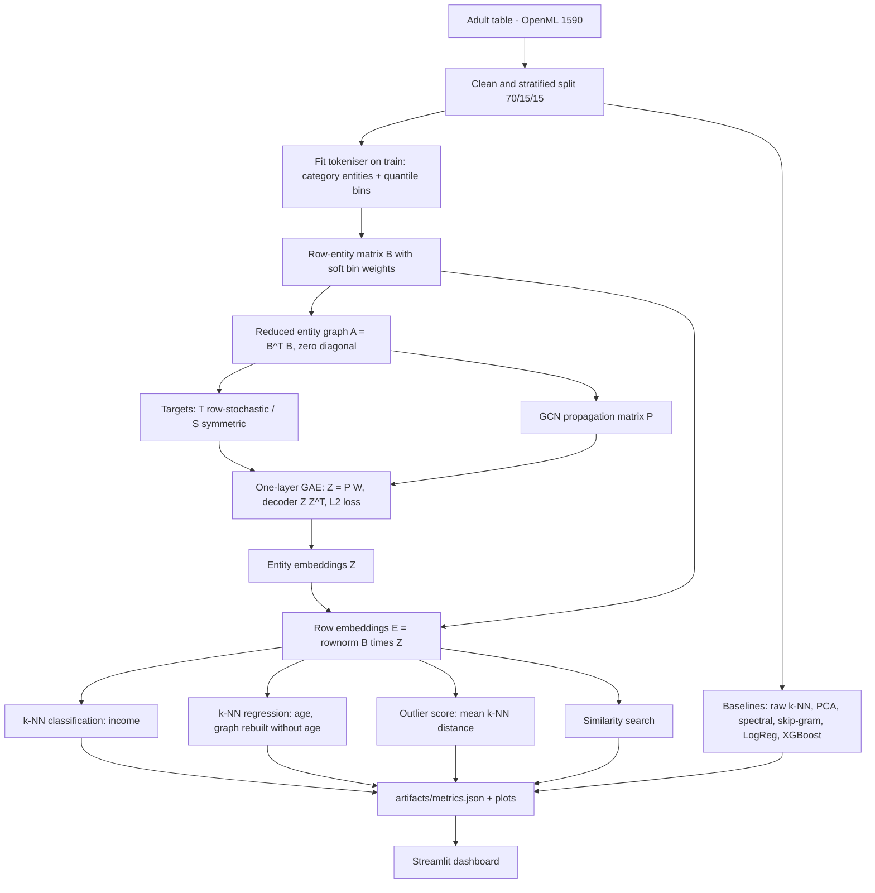

# 05 - Model Design

## Components

### 1. Entity tokeniser (`TableTokeniser`)

Fitted on training rows. Produces a vocabulary of entities and, for any dataframe, a sparse
row-entity matrix **B** (rows x entities).

- Categorical cell `c = v` -> entry 1.0 at entity `c=v`.
- Numerical cell `c = x` -> let m_1 < ... < m_K be the bin centres of column c (mean of the
  training values in each quantile bin). If m_j <= x <= m_{j+1}, with t = (x - m_j) /
  (m_{j+1} - m_j): entry (1 - t) at bin j and t at bin j+1. Below m_1 or above m_K the whole
  weight goes to the outer bin.
- Zero-inflated columns: exact zero -> a dedicated `c=0` entity.
- Each row therefore has total weight = number of used columns (12).
- Unknown category at inference -> no entry (reported as "unseen entity").

This is a re-implementation of the idea behind Equation 1 of the paper (weight depends on the
position in the bin; neighbours share mass near borders), not a copy of the exact formula.

### 2. Reduced entity graph

- A = B^T B, diagonal set to 0. Entry A_ij = sum over rows of w_ri * w_rj.
- T = D^-1 A (row-stochastic transition matrix), the paper's reconstruction target.
- Ablation target: S = D^-1/2 A D^-1/2 (symmetric).
- Encoder propagation matrix: P = D~^-1/2 (A + I) D~^-1/2 (standard GCN normalisation).

### 3. Graph auto-encoder (`EntityGAE`, PyTorch)

- Node features: identity (one-hot node id), so the single GCN layer is `Z = P W` with
  W in R^{n x d}, no bias, no non-linearity (one-layer encoder as in the paper).
- Decoder: `R = Z Z^T`.
- Loss: `(1 - alpha) * mean((R - s*Target)^2) + alpha * mean(|R - s*Target|)` with alpha = 0 and
  scale s = n (so the average target entry is 1).
- Parameter count: n * d (the exact value is written to `artifacts/metrics.json`).

### 4. Row embedder

`E = diag(1 / rowsum(B)) B Z` - the weighted mean of entity vectors. Works for any new row.

### 5. Downstream heads (no training beyond storing the training embeddings)

- Classification / regression: brute-force Euclidean k-NN (`src/evaluate.py`), neighbour
  weights "distance" or "uniform" chosen on validation.
- Outlier score: mean distance to the k nearest training embeddings.
- Similarity search: nearest training rows.

## Pipeline diagram

## Hyper-parameters

| Item | Value | Source |
|------|-------|--------|
| Embedding dimension d | 16 (sweep: 2, 4, 8, 16, 32, 64) | paper sweeps d; 15 was enough on Rossmann |
| Quantile bins, dense numerical columns | up to 20 | paper used 20 for Age and Fare |
| Quantile bins, non-zero part of capital columns | up to 10 | project choice |
| Optimiser | Adam, lr 0.01 | paper lr 0.01 |
| Gradient-norm clip | 1.0 | paper clips (to a much smaller value); project choice for the rescaled loss |
| Max epochs | 10,000 (raised from 3,000 in Phase 2: runs were still improving at the cap; early stop now ends them) | budget |
| Early stop | relative loss improvement below 0.1% over 200 epochs | paper: 0.1% over 10,000 epochs, shortened for the budget |
| Loss mix alpha | 0 (pure L2) | paper |
| Weight init | Gaussian, std 0.1, seeded | project choice |
| Reconstruction target | T (row-stochastic) vs S (symmetric), picked on validation AUC | T is the paper's; S is the ablation |
| k for k-NN | best of {5, 15, 25, 50, 100} on validation | project choice |
| k-NN neighbour weights | distance or uniform, chosen on validation together with k, for every method including the baseline (Phase 2 change: the table has many exact duplicate rows, and pure distance weighting lets one duplicate decide the vote) | project choice |
| Seeds | 0, 1, 2 for stability; split seed 42 | project choice |
| Skip-gram baseline | walks on the same entity graph, window 3, 5 negatives, walk budget fixed in config | approximation of EmbDI |

Values marked "project choice" may be adjusted once in Phase 2 if training is unstable; the
final values are written to `artifacts/metrics.json` under `config`.

## Baseline models

Task-independent (no labels), then k-NN with the same rule:

1. **Raw ordinal k-NN** - ordinal codes + standardisation. *The simple baseline the model must beat.*
2. **Raw one-hot k-NN** - one-hot + standardised numbers (about 100 dimensions).
3. **PCA-d** - PCA of the one-hot matrix to d dimensions.
4. **Spectral-d** - truncated SVD of the same target matrix; entity vectors U sqrt(S); rows
   embedded exactly like the GAE. Isolates what gradient training adds.
5. **Skip-gram-d (EmbDI-style approximation)** - random walks on the entity graph, skip-gram with
   negative sampling in PyTorch; rows embedded exactly like the GAE.

Trivial: **majority class** (classification), **training mean** (regression).

Supervised references (use labels, not universal): **logistic regression** on one-hot and
**XGBoost** on ordinal-encoded raw columns with default-like settings (no tuning).

## Evaluation protocol

- One fixed stratified split (seed 42). Tokeniser, graph, GAE, scalers and PCA are fitted on
  train only. k and the target normalisation are chosen on validation. Test is used once.
- **Primary metric**: test ROC-AUC, income classification, GAE d = 16.
- Also reported for classification: accuracy, F1 (threshold 0.5), average precision.
- **Stability**: mean and std of test ROC-AUC over 3 GAE seeds.
- **Dimension sweep**: test ROC-AUC vs d for GAE, PCA, spectral, skip-gram.
- **Regression (universality)**: remove `age` from the tokeniser, rebuild graph, retrain GAE,
  k-NN regression of age; MAE, RMSE, R^2 vs the training-mean baseline and vs XGBoost regression.
- **Outlier detection**: make corrupted copies of test rows by replacing a random half of the
  cells with values drawn from other rows (per-column shuffle, seeded). Score = mean distance to
  k nearest training embeddings. ROC-AUC of corrupted vs original; same protocol for PCA and
  one-hot features.
- **Neighbour quality**: for each test row, share of its 10 nearest training rows with the same
  income label, compared with the chance level implied by class balance.
- **Timing**: seconds per stage and total.
- Every number is written to `artifacts/metrics.json`; README and dashboard read from it.
