# 06 - Results

Every number on this page is copied from `artifacts/metrics.json` (written by `python train.py`)
or counted from `artifacts/sample_predictions.csv`. Differences and ratios are simple arithmetic
on those numbers. Nothing is estimated or taken from memory.

Setup in one line: Adult Census Income (OpenML id 1590), 48,842 rows, stratified split into
34,188 train / 7,327 validation / 7,327 test rows (split seed 42). The embedding never sees the
`income` column. A k-NN classifier on the frozen row embeddings is scored on the test split.

## 1. Headline

| | Test ROC-AUC |
|---|---|
| **Main model: GAE row embedding (d = 16) + k-NN** | **0.8963** |
| Baseline to beat: k-NN on ordinal-encoded, standardised raw columns | 0.8796 |
| Difference | +0.0167 |

The success criterion from `02_problem_definition.md` is met: the label-free 16-dimensional
embedding beats the "no embedding" baseline and the majority-class predictor (0.5000).

The honest second half of the headline: the graph auto-encoder is **not** the best label-free
embedding in this study. A closed-form spectral factorisation of the same matrix (0.9063), a
random-walk skip-gram model (0.9019) and even k-NN on the 106-dimensional one-hot encoding
(0.9013) score higher. Only PCA at 16 dimensions (0.8957) is lower, and that gap is smaller than
the seed-to-seed spread of the GAE.

## 2. Classification: all methods on the same test split

| Method | Uses labels to build features? | Dim | k (weights) | ROC-AUC | Accuracy | F1 | Avg. precision |
|---|---|---|---|---|---|---|---|
| XGBoost on raw columns | yes (supervised) | 12 | - | 0.9322 | 0.8791 | 0.7224 | 0.8389 |
| Spectral embedding + k-NN | no | 16 | 100 (uniform) | 0.9063 | 0.8516 | 0.6530 | 0.7615 |
| Logistic regression on one-hot | yes (supervised) | 106 | - | 0.9024 | 0.8496 | 0.6528 | 0.7469 |
| Skip-gram embedding + k-NN (EmbDI-style approximation) | no | 16 | 100 (uniform) | 0.9019 | 0.8488 | 0.6386 | 0.7519 |
| k-NN on raw one-hot | no | 106 | 50 (uniform) | 0.9013 | 0.8484 | 0.6671 | 0.7442 |
| **GAE embedding + k-NN (main model)** | **no** | **16** | **25 (uniform)** | **0.8963** | **0.8480** | **0.6572** | **0.7419** |
| PCA embedding + k-NN | no | 16 | 50 (uniform) | 0.8957 | 0.8489 | 0.6480 | 0.7391 |
| k-NN on raw ordinal (baseline) | no | 12 | 50 (uniform) | 0.8796 | 0.8314 | 0.6317 | 0.6917 |
| Majority class | - | - | - | 0.5000 | 0.7607 | 0.0000 | 0.2393 |

Notes:

- k and the neighbour weighting were chosen on the validation split for every k-NN method.
  Uniform weights won for all of them (see section 6 for why).
- Accuracy is nearly the same for all label-free methods (0.848 to 0.852). The methods differ
  mostly in ranking quality (ROC-AUC, average precision).
- The gap to supervised XGBoost is 0.0359 ROC-AUC. This is the price of never seeing the label
  and of using a plain k-NN on top.

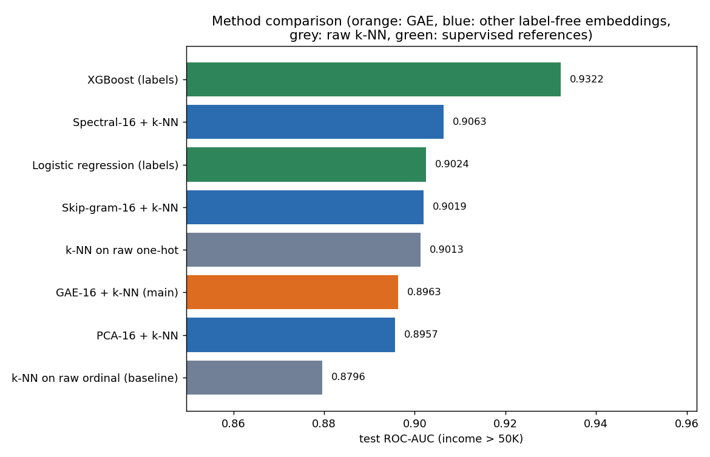

*Interpretation.* The orange bar (main model) sits above the grey raw-ordinal baseline and next
to PCA, but below the other two graph-based embeddings and below raw one-hot k-NN. All label-free
methods except the baseline fall in a narrow band of about 0.011 ROC-AUC (0.8957 to 0.9063).

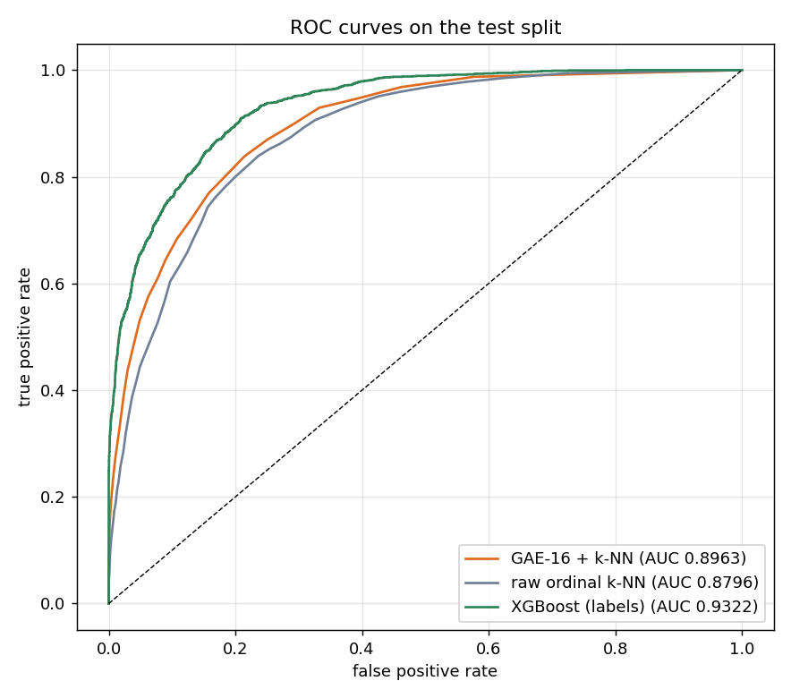

*Interpretation.* The GAE curve is above the raw ordinal baseline over the whole range and below
XGBoost over the whole range. The three curves meet near the top right, so the differences come
from the low false-positive region, where ranking the most confident cases matters.

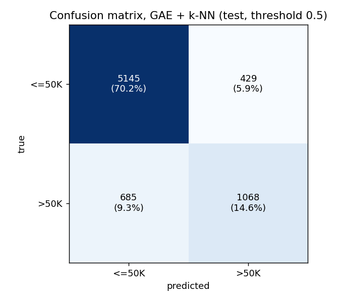

*Interpretation.* At threshold 0.5 the main model gives TN 5,145, FP 429, FN 685, TP 1,068. From
these counts: recall on the `>50K` class is 1,068 / 1,753 = 0.609, precision is
1,068 / 1,497 = 0.713. The model misses high earners more often than it wrongly flags low
earners, which is expected with 23.9% positives and a majority vote of 25 neighbours.

## 3. Stability and the reconstruction-target ablation

| Target | Validation ROC-AUC (mean +- std, 3 seeds) | Test ROC-AUC (mean +- std, 3 seeds) |
|---|---|---|
| T, row-stochastic (paper's choice, chosen here on validation) | 0.8903 +- 0.0003 | 0.8982 +- 0.0014 |
| S, symmetric (ablation) | 0.8885 +- 0.0017 | 0.8960 +- 0.0019 |

Test ROC-AUC per seed, target T: 0.8963 (seed 0, the saved model), 0.8989 (seed 1),
0.8994 (seed 2).

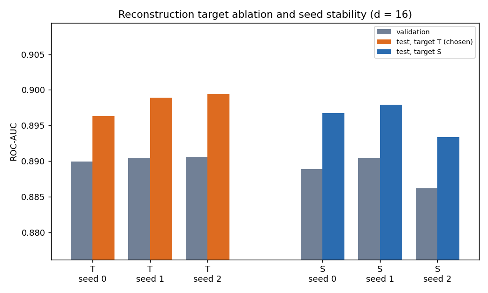

*Interpretation.* Training is stable: the spread over seeds is about 0.001 to 0.002. The saved
model (seed 0) happens to be the lowest of the three T runs, so the headline number is not a
lucky seed. T is only 0.0022 better than S on test, which is about the size of the spread, so
with 3 seeds this ablation does not show a clear winner. The gap to the spectral embedding
(0.9063 vs a GAE mean of 0.8982) is about six times the GAE standard deviation, so that gap is
not seed noise. The gap to PCA (0.8957) is inside the noise.

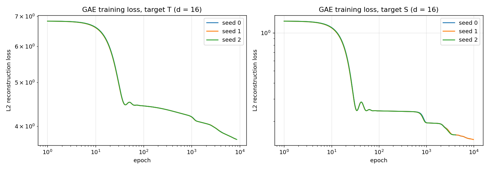

*Interpretation.* The three seeds lie on top of each other. The loss drops quickly in the first
50 epochs, then keeps improving slowly in steps (new directions of the matrix are picked up one
after another). The main run stopped by the early-stopping rule after 8,216 epochs with a final
loss of 3.7455. The 16-dimensional factorisation explains a share of 0.358 of the variance of
the target matrix (`explained_share` = 1 - loss / target variance), so most of the co-occurrence
structure is not captured at d = 16.

## 4. Dimension sweep

Test ROC-AUC by embedding dimension d:

| d | GAE | PCA | Spectral | Skip-gram |
|---|---|---|---|---|
| 2 | **0.8671** | 0.8562 | 0.8548 | 0.6656 |
| 4 | 0.8819 | **0.8826** | 0.8823 | 0.8571 |
| 8 | 0.8955 | 0.8881 | **0.8980** | 0.8941 |
| 16 | 0.8963 | 0.8957 | **0.9063** | 0.9019 |
| 32 | 0.8988 | 0.9008 | **0.9068** | 0.9047 |
| 64 | 0.8993 | 0.9019 | 0.9039 | **0.9040** |

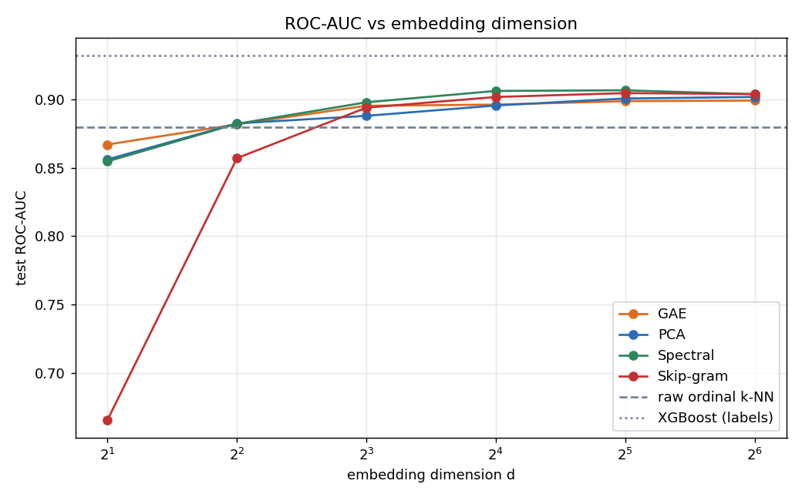

*Interpretation.* The GAE is the best method at d = 2 and second best at d = 8, so it is a good
choice when the embedding must be very small. From d = 16 upward it flattens (0.8963 to 0.8993)
while the others keep improving, and at d = 32 and d = 64 it is the lowest of the four. All
methods pass the raw-ordinal baseline (0.8796) from d = 4 (skip-gram from d = 8). None reaches
XGBoost (0.9322) at any dimension. The sweep uses one seed per point.

## 5. Is the embedding "universal"? Three other uses of the same pipeline

### 5.1 Age regression (age column removed from the graph, then predicted)

| Method | MAE (years) | RMSE | R^2 |
|---|---|---|---|
| XGBoost regression (supervised) | 7.56 | 9.78 | 0.485 |
| **GAE embedding + k-NN (k = 25)** | **8.02** | **10.44** | **0.414** |
| k-NN on raw ordinal columns (k = 15) | 8.11 | 10.62 | 0.394 |
| Predict the training mean | 11.16 | 13.64 | -0.001 |

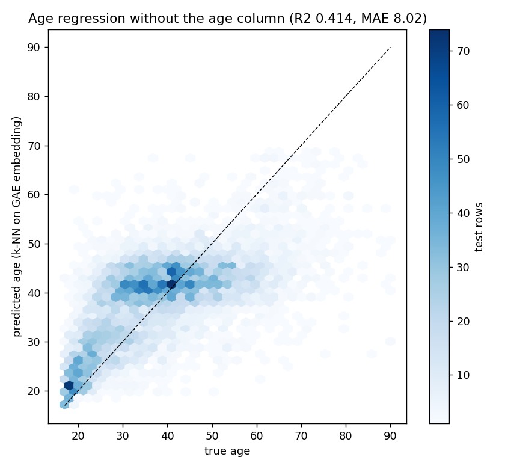

*Interpretation.* The secondary criterion (R^2 > 0) is met. The embedding cuts the error of the
mean predictor by about 3.1 years and is slightly better than raw k-NN (by 0.08 years MAE). The
plot shows the usual k-NN regression effect: predictions are pulled to the middle (most
predictions are between 20 and 55), so the youngest people are predicted well and people above
60 are under-predicted. The other columns simply do not determine age precisely.

### 5.2 Outlier detection (corrupted copies of test rows vs. originals)

Half of the cells of each test row were replaced by values from other rows; because many
replacement values equal the original, the share of cells that really changed is 0.272. The
score is the mean distance to the 10 nearest training rows.

| Feature space | ROC-AUC (corrupted vs. original) |
|---|---|
| **GAE embedding (d = 16)** | **0.7954** |
| Raw one-hot | 0.7567 |
| PCA (d = 16) | 0.7520 |
| Raw ordinal | 0.7184 |

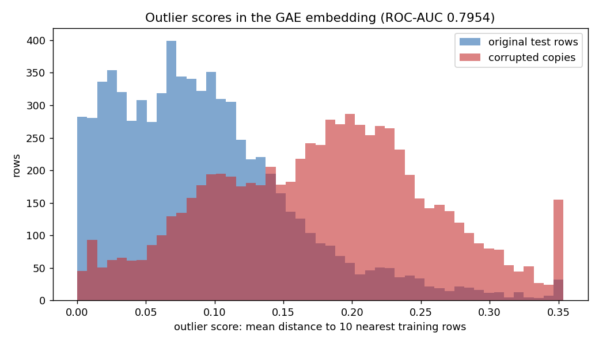

*Interpretation.* This is the one task where the GAE embedding is the best of the compared
spaces. The two histograms are clearly shifted but overlap a lot: a corrupted row with only a
few changed cells can still look like a normal person. The spectral and skip-gram embeddings
were not scored on this task, so no claim is made against them here.

### 5.3 Neighbour quality (similarity search)

For each test row, the share of its 10 nearest training rows with the same income label is
0.799 on average, against a chance level of 0.636 implied by class balance and 0.784 for raw
ordinal features. It is uneven: 0.865 for `<=50K` queries but only 0.589 for `>50K` queries.
High earners often have low-earning look-alikes.

## 6. Other plots

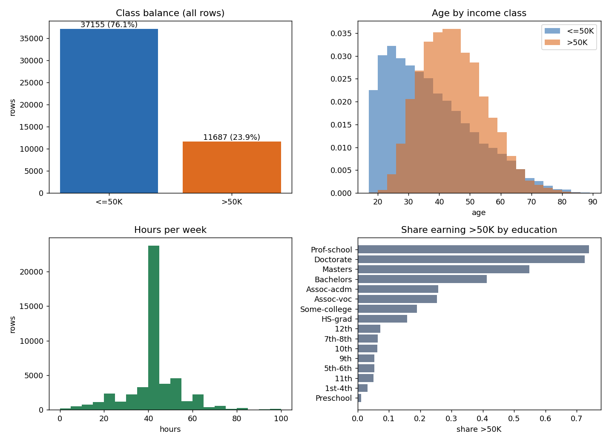

*Interpretation.* 76.1% of rows are `<=50K`. High earners are older on average, most people
report about 40 hours per week, and the share of high earners rises steeply with education.
These are the signals a label-free embedding can pick up through co-occurrence. The table also
has 7,403 rows whose 12 feature values duplicate an earlier row. With distance-weighted votes a
single exact duplicate (distance 0) decides the whole prediction, which is why uniform weights
won on validation for every method (for the GAE: 0.8900 uniform vs 0.8701 distance-weighted at
k = 25).

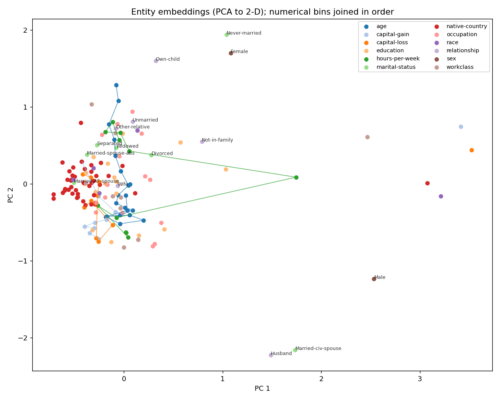

*Interpretation.* This is a 2-D PCA view of the 153 entity vectors. Entities that occur together
sit together: `Husband`, `Married-civ-spouse` and `Male` are in one corner; `Never-married`,
`Own-child` and `Female` in the opposite one. The bins of a numerical column are joined in order
and mostly form a path (age is the clearest), so the soft binning keeps numerical order. A few
points lie far to the right; these are the most frequent entities (`capital-loss=0`,
`capital-gain=0`, `race=White`, `native-country=United-States`), whose position reflects how
often they occur rather than what they mean.

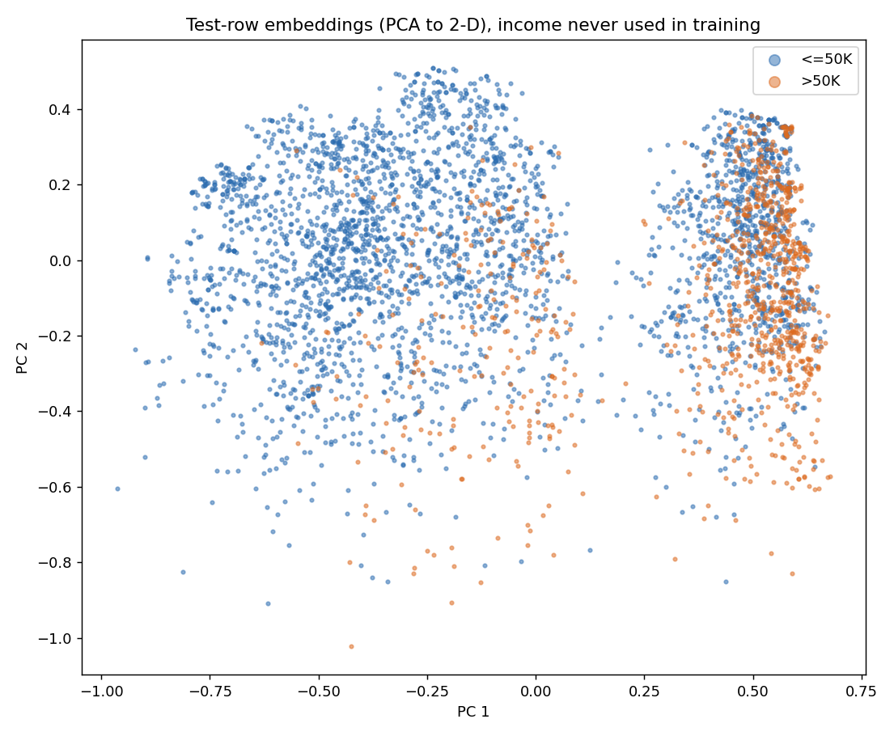

*Interpretation.* Test rows form two large groups along the first component. Given the entity
map, this split follows the marital-status / relationship block. Almost all high earners are in
the right-hand group, but that group also holds many low earners, mixed closely. This picture
matches the error analysis below.

## 7. Error analysis

Source: `artifacts/sample_predictions.csv`, a 500-row sample of test predictions (accuracy in the
sample: 428 / 500 = 0.856, close to the full-test 0.848).

**Kinds of error.** 72 of the 500 predictions are wrong: 51 are missed high earners (true
`>50K`, predicted `<=50K`) and 21 are false alarms. The same asymmetry appears in the full test
confusion matrix (685 FN vs 429 FP).

**Where the errors are.**

| Group (sample rows) | Rows | Correct | Accuracy |
|---|---|---|---|
| marital-status = Married-civ-spouse | 232 | 177 | 0.763 |
| marital-status = Never-married | 155 | 149 | 0.961 |
| marital-status = Divorced | 79 | 72 | 0.911 |
| relationship = Husband | 204 | 154 | 0.755 |
| relationship = Own-child | 78 | 78 | 1.000 |
| sex = Male | 330 | 270 | 0.818 |
| sex = Female | 170 | 158 | 0.929 |
| age 17-25 | 102 | 98 | 0.961 |
| age 46-55 | 96 | 76 | 0.792 |
| age 56-65 | 46 | 35 | 0.761 |
| capital-gain > 0 | 40 | 37 | 0.925 |

55 of the 72 errors (76%) are married people (`Married-civ-spouse`). This does not mean the
model is "worse for men" in a causal sense: groups with almost no high earners (young,
never-married, own-child) are easy because predicting `<=50K` is nearly always right, while the
married, middle-aged group is where the two classes are really mixed.

**Confidence is informative.**

| Confidence (share of neighbours agreeing with the prediction) | Rows | Accuracy |
|---|---|---|
| 0.5 - 0.6 | 55 | 0.636 |
| 0.6 - 0.7 | 47 | 0.681 |
| 0.7 - 0.8 | 75 | 0.787 |
| 0.8 - 0.9 | 60 | 0.817 |
| 0.9 - 1.0 | 263 | 0.962 |

More than half of the sample has confidence above 0.9 and is right 96% of the time; the errors
concentrate where the neighbour vote is close. A practical system could pass low-confidence rows
to a person.

**Why these errors happen.**

1. The embedding is a *mean* of entity vectors. It cannot represent interactions such as
   "this occupation matters only together with this education level".
2. The embedding is label-free, so it gives the same importance to columns that matter for
   income as to columns that do not (for example the 42 native-country entities).
3. Probabilities come from 25 votes, so they move in steps of 0.04 and the 0.5 threshold is
   coarse for a class with 23.9% positives (F1 0.657 at this threshold).
4. Some information is simply not in the table: two people identical in all 12 columns can have
   different incomes (see the duplicate rows above).

## 8. Comparison with the source paper

The source paper (Franz et al., arXiv:2507.05904) claims that its embeddings, used with a simple
k-NN, perform "in the same range" as supervised references and better than the EmbDI baseline. As
recorded in `01_literature_survey.md`, the paper's text gives exact values only for the references
(XGBoost AUC 0.931 and TabPFN AUC 0.946 on Titanic; XGBoost RMSPE 0.2153 on Rossmann); the
numbers for the proposed method are only shown in figures.

**The setups differ, so numbers must not be compared directly:**

| | Source paper | This project |
|---|---|---|
| Datasets | Titanic (817 train / 74 test), Rossmann (759,917 / 84,475) | Adult Census Income (34,188 / 7,327 / 7,327) |
| Tasks | AUC on Titanic, RMSPE on Rossmann | ROC-AUC on income; plus age regression, outlier detection, neighbour quality |
| Numerical weighting | Equation 1 of the paper | re-implementation: linear interpolation between neighbouring bin centres |
| Stopping rule | relative improvement below 0.1% over 10,000 epochs | same threshold over 200 epochs, cap 10,000 epochs |
| k-NN weights | distance-weighted | distance or uniform, chosen on validation (uniform won) |
| Random-walk baseline | EmbDI, 1,000,000 sentences | own PyTorch skip-gram on the entity graph, 100 walks per node of length 10: an approximation, not EmbDI |
| Supervised references | XGBoost, TabPFN | XGBoost and logistic regression, untuned (TabPFN not available) |

**What agrees with the paper's claims (on this different dataset):**

- A label-free embedding plus k-NN gets into the range of a supervised linear model
  (0.8963 vs 0.9024 for logistic regression) and stays 0.0359 below XGBoost. "Same range, somewhat
  lower than boosted trees" is a fair description here too.
- A small dimension is enough: going from d = 16 to d = 64 adds only 0.0030.
- Training cost does not depend on the number of rows: the graph has 153 nodes and the model has
  2,448 parameters; the main GAE run took 50.5 s on CPU.
- New rows are embedded by an average; validation and test contained 0 cells without a known
  entity.

**What does not agree, or what the paper did not test:**

- The paper reports its method ahead of the random-walk baseline. Here the skip-gram
  approximation is ahead of the GAE at d = 16 (0.9019 vs 0.8963) and at d = 32 and 64. This is
  not a like-for-like test of EmbDI: the walks here run on the already-reduced weighted entity
  graph, which may help the baseline. At d = 2 and d = 4 the GAE is clearly ahead
  (0.8671 vs 0.6656 at d = 2).
- The paper has no PCA or spectral baseline. Here a truncated SVD of the *same* target matrix,
  with rows embedded in the same way, is better than gradient-trained GAE at d >= 8. So on this
  table the gradient training of the auto-encoder adds nothing over a closed-form factorisation
  for classification. One likely reason, not tested here: the symmetric decoder Z Z^T cannot fit
  an asymmetric row-stochastic target, and the single-seed 16-dimensional GAE explains only a
  0.358 share of it.
- The paper claims outlier detection and similarity search as uses but does not measure them.
  Here they were measured, and outlier detection is where the GAE embedding does best
  (0.7954 vs 0.7520 to 0.7567 for PCA and one-hot).

## 9. Limitations

- **One dataset, one split.** All conclusions are for Adult with split seed 42. Test scores are
  higher than validation scores for every method (for example 0.8963 vs 0.8900 for the GAE),
  which shows that split-to-split variation is of the same size as several of the gaps between
  methods.
- **Seeds.** Only the GAE was run with 3 seeds. Skip-gram is also stochastic and was run once.
  The dimension sweep has one seed per point.
- **Model selection is small.** Only k and the neighbour weighting are tuned (on validation).
  XGBoost and logistic regression are untuned, so the gap to supervised learning is probably
  under-estimated.
- **Synthetic outliers.** The outlier test uses artificially corrupted rows; real anomalies may
  behave differently. Spectral and skip-gram embeddings were not scored on it.
- **Approximations.** The numerical weighting and the random-walk baseline are re-implementations,
  not the paper's Equation 1 and not the EmbDI tool.
- **Method limits.** Row embeddings are linear in the entities (no interactions); a category
  never seen in training has no vector and is skipped; a single table only, no joins.
- **Data.** Adult is 1994 US census data with known social biases (the error analysis shows
  strong dependence on sex and marital status). The model is a demonstration and must not be
  used to judge real people.

## 10. Future work

1. Repeat on more tables and several split seeds to see whether "spectral >= GAE" holds in general.
2. Try an asymmetric decoder (two embedding matrices) or a deeper encoder, to test the
   symmetric-decoder explanation above.
3. Weight columns or entities (for example by inverse frequency) so that very frequent entities
   do not dominate the row mean.
4. Replace the mean by an aggregation that can express interactions between entities.
5. Extend the graph to several joined tables, the setting the paper motivates but does not test.
6. Run the original EmbDI tool and TabPFN for a like-for-like comparison with the paper.
7. Score all embeddings on the outlier and regression tasks, with real labelled anomalies.
