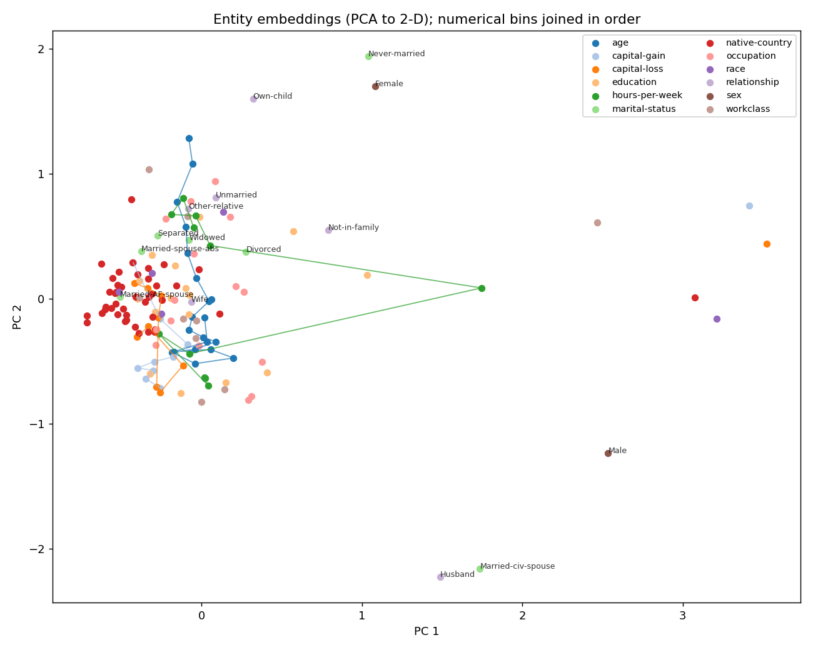
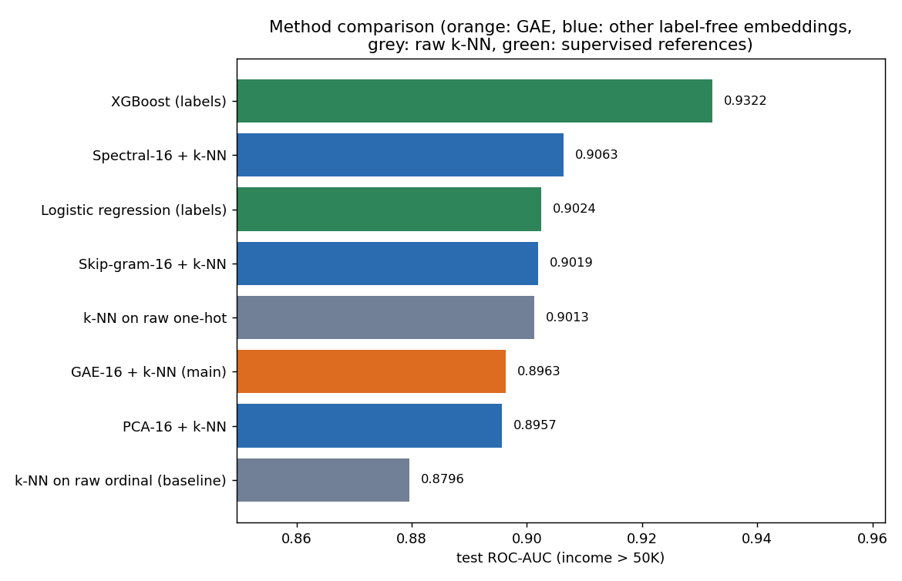
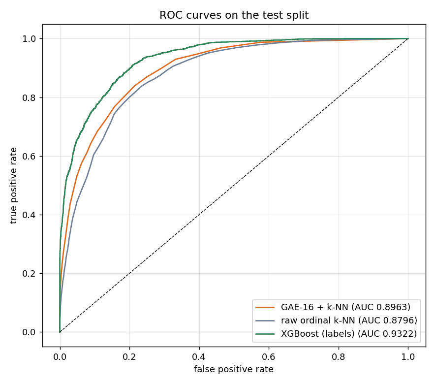
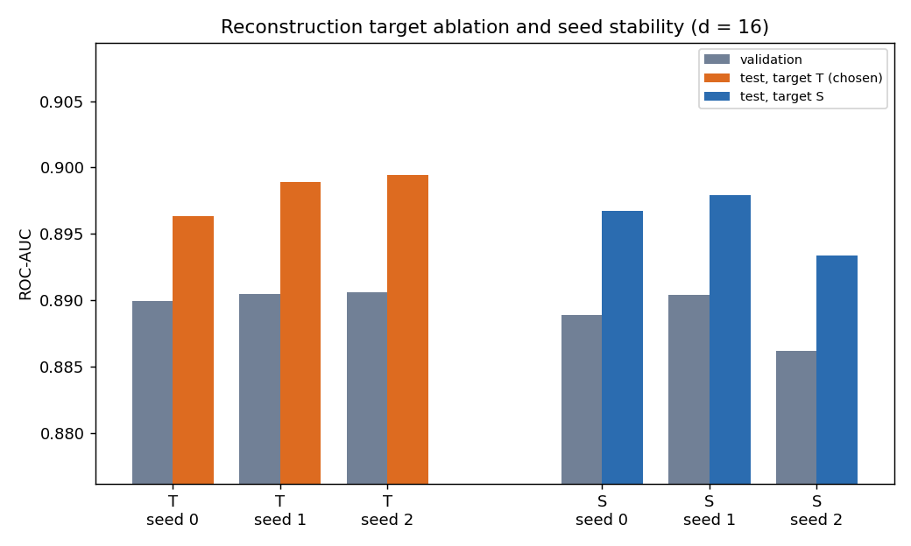
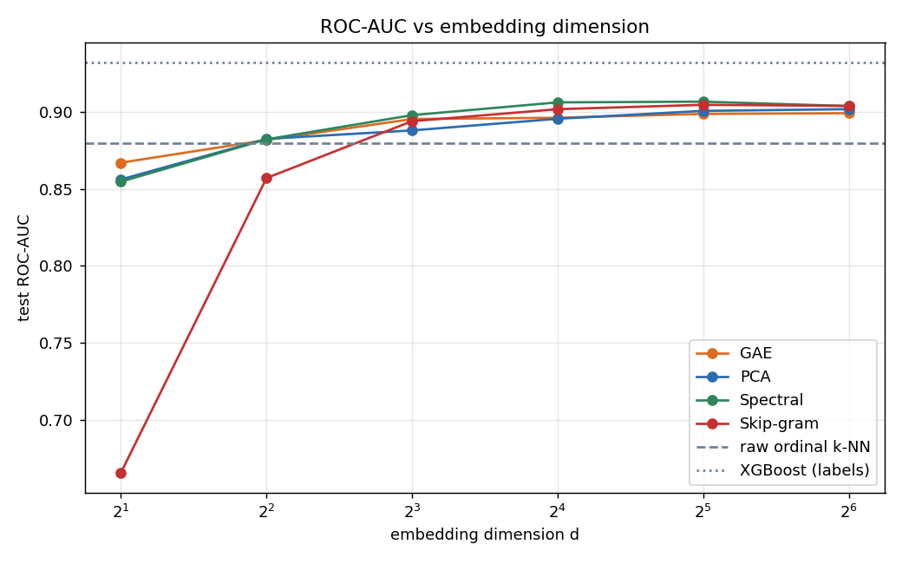
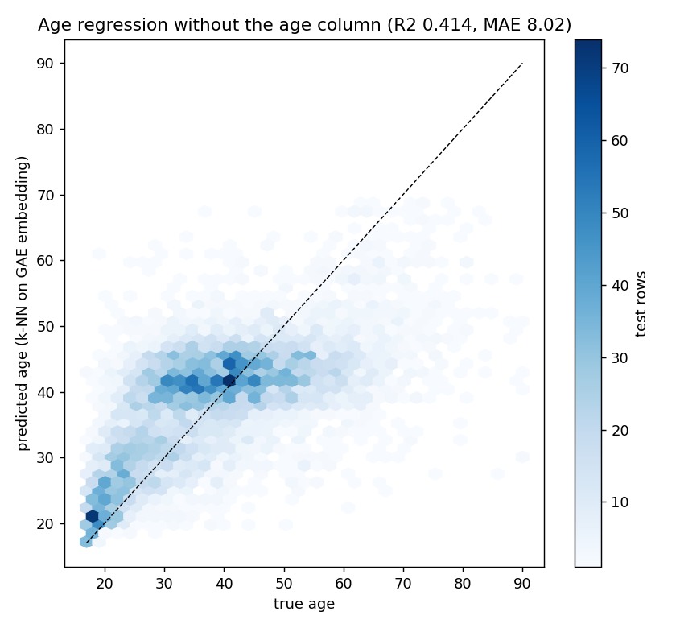
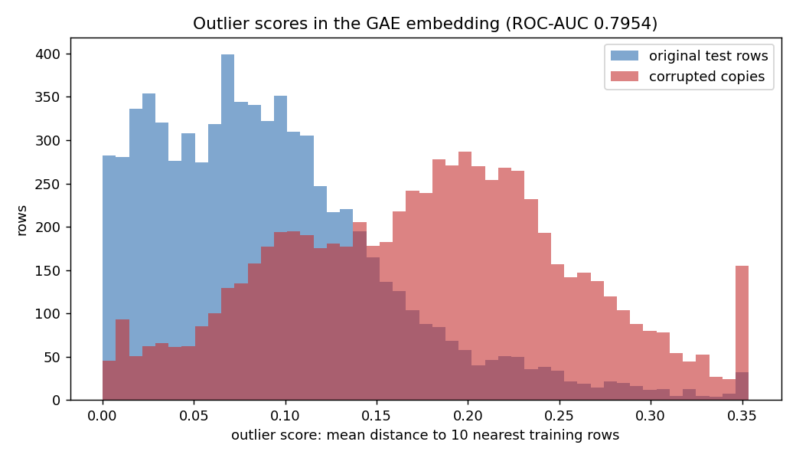

# Universal Embeddings of Tabular Data on a CPU Budget: A Reproduction and Baseline Study on Adult Census Income

## Abstract

Universal embeddings turn each row of a table into a vector without using any target column, so
that one representation can serve tasks that are not known in advance. Franz et al. proposed to
build a weighted graph of table entities (categories and numerical bins), train a one-layer graph
auto-encoder (GAE) on it, and embed a row as the weighted mean of its entity vectors. The
original evaluation used two datasets and one random-walk baseline. This paper re-implements the
pipeline from scratch and tests it on Adult Census Income (48,842 rows) with cheap baselines the
original study did not include. With 16 dimensions and a k-nearest-neighbour classifier, the GAE
embedding reaches a test ROC-AUC of 0.8963, above k-NN on ordinal-encoded raw columns (0.8796)
and 0.0359 below supervised XGBoost (0.9322). Over three seeds the GAE scores 0.8982 +- 0.0014.
However, a closed-form spectral factorisation of the same graph matrix (0.9063), a random-walk
skip-gram model (0.9019) and k-NN on one-hot features (0.9013) are all better at this dimension;
only PCA (0.8957) is lower. The GAE is the best method at 2 dimensions and gives the best
outlier-detection score among the tested spaces (ROC-AUC 0.7954 against 0.7520 to 0.7567). The
same pipeline predicts a held-out age column with R^2 0.414. The whole study trains in 146
seconds on a laptop CPU. We conclude that the entity-graph construction is useful, while the
gradient-trained auto-encoder itself was not needed on this table.

## Index Terms

Tabular data, universal embeddings, representation learning, graph auto-encoder, entity graph,
k-nearest neighbours, outlier detection, reproducibility.

## I. Introduction

Much industrial data lives in tables, and the questions asked of a table are usually not known
when it is created. Training one supervised model per question is expensive. A universal
embedding is a task-independent alternative: every row gets one vector, and classification,
regression, similarity search and outlier detection become distance computations.

Franz et al. [1] proposed a compact way to obtain such embeddings. Every distinct categorical
value and every bin of a numerical column becomes an *entity*. Entities that occur in the same
row are linked in a weighted graph, a one-layer graph auto-encoder [3] learns one vector per
entity, and a row is embedded as the weighted mean of its entities. The model size depends on
the number of entities, not on the number of rows.

The evaluation in [1] is small: two datasets, one task each, a 74-row test set for one of them,
and a single universal baseline (EmbDI [2]). Two questions stay open. Does the method hold on a
larger, noisier table? And does the trained auto-encoder beat much simpler embeddings built from
the same information?

This paper makes four contributions:

1. A from-scratch, CPU-only re-implementation of the pipeline, with every departure from [1]
   stated.
2. An evaluation on Adult Census Income with a 7,327-row test set.
3. A comparison at equal dimension with PCA, a closed-form spectral factorisation of the same
   target matrix and a random-walk skip-gram model, plus raw-feature k-NN and two supervised
   references.
4. Measurements of the "universal" claim on three further uses: regression of a held-out
   column, outlier detection and neighbour quality, together with a seed-stability study.

All numbers in this paper are read from the file `artifacts/metrics.json` produced by the
released code.

## II. Related Work

**Graph-based table embeddings.** EmbDI [2] builds a graph of cell values, rows and attributes,
samples random walks as "sentences" and trains word-embedding models on them. It targets data
integration and needs many sampled walks. The graph auto-encoder of Kipf and Welling [3] learns
node embeddings with a GCN encoder and an inner-product decoder that reconstructs the adjacency
matrix; it was designed for link prediction on citation networks. The source paper [1] combines
both ideas: a deterministic entity graph instead of sampled walks, and a one-layer GAE on it. Li
et al. [10] survey graph neural networks for tabular data and argue that graphs capture
correlations among instances and feature values that plain deep tabular models under-use.

**Self-supervised row encoders.** VIME [4] trains an encoder with mask estimation and value
imputation. SCARF [5] uses contrastive learning with views made by replacing random features with
draws from the column marginals. SubTab [6] reconstructs all features from feature subsets. These
methods learn a neural row encoder per table and are mostly evaluated after supervised
fine-tuning, not as frozen embeddings with a simple k-NN.

**Supervised tabular models.** TabTransformer [7] learns contextual category embeddings for a
supervised objective. TabPFN [8] performs in-context classification with a transformer
pre-trained on synthetic tasks and was evaluated on small datasets. Grinsztajn et al. [9] show
that tree-based models stay state of the art on medium-sized tables, which motivates gradient
boosted trees as the supervised reference in this study.

## III. Methodology

### A. Entities and the row-entity matrix

A tokeniser is fitted on the training rows. A categorical cell `c = v` gives weight 1 to the
entity `c=v`. A numerical column is cut into quantile bins (up to 20; up to 10 for the non-zero
part of zero-inflated columns, which also get a dedicated zero entity). A numerical value x
between two neighbouring bin centres m_j and m_{j+1} gives weight 1 - t to bin j and t to bin
j + 1, with t = (x - m_j) / (m_{j+1} - m_j). This keeps numerical order and lets neighbouring bins
share mass. It re-implements the idea of Equation 1 in [1], not its exact formula. The result is
a sparse matrix B (rows x entities) in which every row sums to the number of columns.

### B. Reduced entity graph

Row nodes are eliminated: A = B^T B with the diagonal set to zero, so A_ij is the summed product
of the weights of entities i and j over all rows. The reconstruction target is the row-stochastic
transition matrix T = D^-1 A, as in [1]. A symmetric variant S = D^-1/2 A D^-1/2 is used as an
ablation. The encoder uses the usual GCN normalisation P = D~^-1/2 (A + I) D~^-1/2 [3].

### C. Graph auto-encoder

Node features are the identity, so the one-layer encoder is Z = P W with W of size n x d, with
no bias and no non-linearity. The decoder is the inner product Z Z^T. The loss is the mean
squared error between Z Z^T and the target scaled by n (pure L2, mixing weight alpha = 0 as in
[1]). The model has n x d parameters.

### D. Row embeddings and downstream heads

A row embedding is the weighted mean of its entity vectors, E = diag(1 / rowsum(B)) B Z. New rows
need no training; a cell with an unknown category is skipped. Classification and regression use
Euclidean k-NN on the training embeddings. The outlier score of a row is its mean distance to
the k nearest training embeddings.

Fig. 1. Entity embeddings projected to two dimensions. Co-occurring entities lie together
(`Husband`, `Married-civ-spouse`, `Male`), and the bins of a numerical column form an ordered
path.

## IV. Experimental Setup

**Data.** Adult Census Income, OpenML id 1590: 48,842 rows, 8 categorical and 4 numerical input
columns (`fnlwgt` and `education-num` are dropped), target `income > 50K` with 23.9% positives.
Missing categories are kept as their own level. A stratified split (seed 42) gives 34,188
training, 7,327 validation and 7,327 test rows. The resulting graph has 153 entities and 8,473
edges (density 0.729). No validation or test cell lacked a known entity.

**Training.** Adam, learning rate 0.01, gradient-norm clipping at 1.0, at most 10,000 epochs,
early stopping when the relative loss improvement over 200 epochs is below 0.1% ([1] uses a
10,000-epoch window). The main model has d = 16 and 2,448 parameters and stopped after 8,216
epochs. Seeds 0, 1 and 2 are run for both targets; the target is chosen by mean validation
ROC-AUC, and the seed-0 model is the reported main model.

**Baselines.** Label-free: (i) k-NN on ordinal-encoded, standardised raw columns, the baseline
to beat; (ii) k-NN on one-hot features (106 dimensions); (iii) PCA of the one-hot matrix;
(iv) a spectral embedding from a truncated SVD of the same target matrix, with rows embedded
exactly as for the GAE; (v) a skip-gram model with negative sampling trained on random walks over
the entity graph (100 walks of length 10 per node, window 3), which approximates EmbDI [2] but is
not the original tool. Supervised references: logistic regression on one-hot features and
XGBoost on the raw columns, both untuned.

**Protocol.** For every k-NN method, k in {5, 15, 25, 50, 100} and the neighbour weighting
(distance or uniform) are chosen on validation; the test split is used once. The primary metric
is test ROC-AUC. A dimension sweep covers d in {2, 4, 8, 16, 32, 64}.

**Universality tests.** (a) Regression: the age column is removed, the graph and GAE are
rebuilt, and age is predicted by k-NN. (b) Outlier detection: half of the cells of each test row
are replaced by values from other rows (a share of 0.272 of cells actually changes), and
corrupted rows are separated from originals by the outlier score with k = 10. (c) Neighbour
quality: the share of the 10 nearest training rows with the same income label.

**Hardware.** A laptop CPU; the complete run, including all baselines and sweeps, took 146.4 s.

## V. Results

### A. Income classification

TABLE I. Test results for income classification (7,327 rows).

| Method | Labels used for features | Dim | ROC-AUC | Accuracy | F1 | Avg. precision |
|---|---|---|---|---|---|---|
| XGBoost | yes | 12 | 0.9322 | 0.8791 | 0.7224 | 0.8389 |
| Spectral + k-NN | no | 16 | 0.9063 | 0.8516 | 0.6530 | 0.7615 |
| Logistic regression | yes | 106 | 0.9024 | 0.8496 | 0.6528 | 0.7469 |
| Skip-gram + k-NN | no | 16 | 0.9019 | 0.8488 | 0.6386 | 0.7519 |
| Raw one-hot k-NN | no | 106 | 0.9013 | 0.8484 | 0.6671 | 0.7442 |
| **GAE + k-NN (main)** | **no** | **16** | **0.8963** | **0.8480** | **0.6572** | **0.7419** |
| PCA + k-NN | no | 16 | 0.8957 | 0.8489 | 0.6480 | 0.7391 |
| Raw ordinal k-NN (baseline) | no | 12 | 0.8796 | 0.8314 | 0.6317 | 0.6917 |
| Majority class | - | - | 0.5000 | 0.7607 | 0.0000 | 0.2393 |

The GAE embedding improves on the baseline by 0.0167 ROC-AUC and is 0.0359 below XGBoost. Among
label-free embeddings at d = 16 it is third of four. Validation selected k = 25 with uniform
weights for the GAE; uniform weights were selected for every method, because the table contains
7,403 duplicated feature rows and a zero-distance duplicate dominates a distance-weighted vote.
The confusion matrix of the main model is TN 5,145, FP 429, FN 685, TP 1,068.

Fig. 2. Test ROC-AUC of all methods.

Fig. 3. ROC curves of the main model, the baseline and XGBoost.

### B. Seed stability and target ablation

TABLE II. ROC-AUC over three seeds (mean +- standard deviation), d = 16.

| Target | Validation | Test |
|---|---|---|
| T (row-stochastic) | 0.8903 +- 0.0003 | 0.8982 +- 0.0014 |
| S (symmetric) | 0.8885 +- 0.0017 | 0.8960 +- 0.0019 |

Training is stable across seeds. The difference between the two targets (0.0022 on test) is of
the same size as the spread, so it is not conclusive. The gap between the spectral embedding and
the GAE mean (0.0081) is about six GAE standard deviations.

Fig. 4. Validation and test ROC-AUC per seed for both reconstruction targets.

### C. Embedding dimension

TABLE III. Test ROC-AUC by embedding dimension (one seed per point).

| d | GAE | PCA | Spectral | Skip-gram |
|---|---|---|---|---|
| 2 | 0.8671 | 0.8562 | 0.8548 | 0.6656 |
| 4 | 0.8819 | 0.8826 | 0.8823 | 0.8571 |
| 8 | 0.8955 | 0.8881 | 0.8980 | 0.8941 |
| 16 | 0.8963 | 0.8957 | 0.9063 | 0.9019 |
| 32 | 0.8988 | 0.9008 | 0.9068 | 0.9047 |
| 64 | 0.8993 | 0.9019 | 0.9039 | 0.9040 |

The GAE leads at d = 2 and saturates from d = 16 (a gain of 0.0030 from 16 to 64 dimensions). At
d = 32 and d = 64 it is the lowest of the four methods.

Fig. 5. Test ROC-AUC against embedding dimension.

### D. Universality

TABLE IV. Age regression with the age column removed from the graph.

| Method | MAE (years) | RMSE | R^2 |
|---|---|---|---|
| XGBoost (supervised) | 7.56 | 9.78 | 0.485 |
| GAE + k-NN | 8.02 | 10.44 | 0.414 |
| Raw ordinal k-NN | 8.11 | 10.62 | 0.394 |
| Training mean | 11.16 | 13.64 | -0.001 |

TABLE V. Outlier detection: ROC-AUC for separating corrupted from original test rows.

| Feature space | ROC-AUC |
|---|---|
| GAE (d = 16) | 0.7954 |
| Raw one-hot | 0.7567 |
| PCA (d = 16) | 0.7520 |
| Raw ordinal | 0.7184 |

For neighbour quality, on average 0.799 of the 10 nearest training rows share the query's income
label (chance level 0.636; raw ordinal features 0.784). The value is 0.865 for low-income queries
and 0.589 for high-income queries.

Fig. 6. Predicted against true age; predictions are compressed towards the middle of the range.

Fig. 7. Outlier scores of original and corrupted test rows in the GAE embedding.

## VI. Discussion and Limitations

**What holds.** The central claim of [1], that a label-free embedding with a plain k-NN performs
in the range of supervised models, is supported on a different and larger table: the GAE
embedding is close to logistic regression (0.8963 against 0.9024) and 0.0359 below XGBoost. The
same pipeline also supports regression and outlier detection without any task-specific training,
and the model is tiny (2,448 parameters).

**What does not hold here.** The trained auto-encoder is not the best way to use the entity
graph on this table. A truncated SVD of the same target matrix, with identical row aggregation,
is better from d = 8 upward, and our skip-gram approximation of the random-walk approach is
better from d = 16 upward, whereas [1] reports its method ahead of EmbDI. The spectral result
suggests that the value lies in the entity graph and the mean aggregation rather than in
gradient training. A possible reason, which we did not test, is the mismatch between the
symmetric decoder Z Z^T and the asymmetric target T; the 16-dimensional GAE explains a share of
0.358 of the target variance. The GAE has clear advantages only at very small dimension and on
the outlier task, where spectral and skip-gram embeddings were not scored.

**Errors.** In a 500-row sample of test predictions (accuracy 0.856), 51 of 72 errors are missed
high earners and 55 of 72 involve married people; accuracy is 0.962 when at least 90% of
neighbours agree and 0.636 when 50 to 60% agree. Mean aggregation cannot express interactions
between entities, and a label-free embedding weights irrelevant columns like relevant ones.

**Limitations.** (1) One dataset and one split; test scores exceed validation scores for all
methods, so split variation is comparable to several gaps between methods. (2) Only the GAE was
run with several seeds. (3) Supervised references are untuned. (4) The numerical weighting and
the random-walk baseline are approximations of [1] and [2]; the datasets, the stopping window and
the k-NN weighting differ from [1], so no number here can be compared directly with the numbers
in [1]. (5) Outliers are synthetic. (6) Adult is 1994 census data with known social biases; the
model is a demonstration, not a tool for decisions about people.

## VII. Conclusion

We re-implemented the universal tabular embedding framework of Franz et al. and evaluated it on
Adult Census Income within a 146-second CPU budget. The 16-dimensional, label-free embedding with
k-NN reaches a test ROC-AUC of 0.8963, above raw-feature k-NN (0.8796) and below XGBoost
(0.9322), and transfers to age regression (R^2 0.414) and outlier detection (ROC-AUC 0.7954). The
added baselines change the picture drawn by the original study: a closed-form spectral
factorisation of the same graph (0.9063) and a skip-gram model (0.9019) give better k-NN
classification at the same dimension. The entity graph is a sound basis for universal embeddings; whether
the auto-encoder adds value beyond a spectral factorisation should be tested on more tables,
with an asymmetric decoder, and on multi-table data.

## References

[1] Franz, Hoppe, Michaelis, and Goebel, "Universal embeddings of tabular data,"
arXiv preprint arXiv:2507.05904, 2025. Accepted at the Tabular Data Analysis (TaDA) workshop at
VLDB 2025. [Online]. Available: http://arxiv.org/abs/2507.05904v1

[2] R. Cappuzzo, P. Papotti, and S. Thirumuruganathan, "Creating embeddings of heterogeneous
relational datasets for data integration tasks," in Proc. ACM SIGMOD, 2020. [Online]. Available:
https://arxiv.org/abs/1909.01120

[3] T. N. Kipf and M. Welling, "Variational graph auto-encoders," NIPS Workshop on Bayesian Deep
Learning, 2016. [Online]. Available: https://arxiv.org/abs/1611.07308

[4] J. Yoon, Y. Zhang, J. Jordon, and M. van der Schaar, "VIME: Extending the success of self-
and semi-supervised learning to tabular domain," in Advances in Neural Information Processing
Systems (NeurIPS), 2020. [Online]. Available:
https://proceedings.neurips.cc/paper/2020/hash/7d97667a3e056acab9aaf653807b4a03-Abstract.html

[5] D. Bahri, H. Jiang, Y. Tay, and D. Metzler, "SCARF: Self-supervised contrastive learning
using random feature corruption," in Proc. ICLR, 2022. [Online]. Available:
https://arxiv.org/abs/2106.15147

[6] T. Ucar, E. Hajiramezanali, and L. Edwards, "SubTab: Subsetting features of tabular data for
self-supervised representation learning," in Advances in Neural Information Processing Systems
(NeurIPS), 2021. [Online]. Available: https://arxiv.org/abs/2110.04361

[7] X. Huang, A. Khetan, M. Cvitkovic, and Z. Karnin, "TabTransformer: Tabular data modeling
using contextual embeddings," arXiv preprint arXiv:2012.06678, 2020. [Online]. Available:
https://arxiv.org/abs/2012.06678

[8] N. Hollmann, S. Mueller, K. Eggensperger, and F. Hutter, "TabPFN: A transformer that solves
small tabular classification problems in a second," arXiv preprint arXiv:2207.01848, 2022.
[Online]. Available: https://arxiv.org/abs/2207.01848

[9] L. Grinsztajn, E. Oyallon, and G. Varoquaux, "Why do tree-based models still outperform deep
learning on tabular data?" arXiv preprint arXiv:2207.08815, 2022. [Online]. Available:
https://arxiv.org/abs/2207.08815

[10] Li, Tsai, Chen, and Liao, "Graph neural networks for tabular data
learning: A survey," arXiv preprint arXiv:2401.02143, 2024. [Online]. Available:
https://arxiv.org/abs/2401.02143
